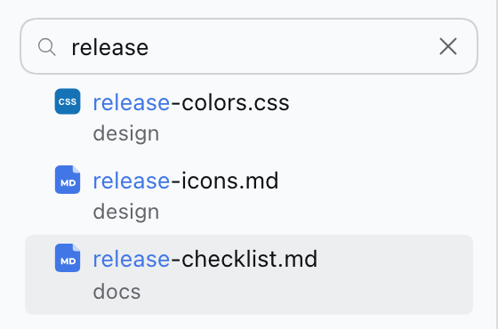
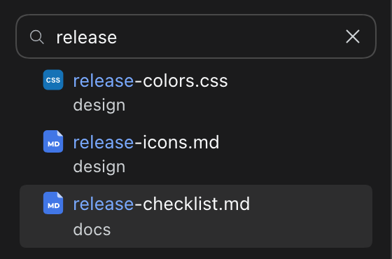

# Workspace files

[简体中文](README.zh.md)

Browse the current session's working directory and the files read or edited
during the current turn below the session list in the left sidebar, and click any file to open DSH's built-in preview.

- Click the workspace header or triangle
  to cycle **current-turn files → all workspace files → collapsed** (hollow dot = read, filled dot = edited).
- Click the magnifying glass to open **Search files or paths**; press `Esc` or the search close button
  to return to the previous view.

Requires DeepSeek Harness `0.2.2-rc.5` (Web client).
Included in **Workspace Modular Improvement Plan** (`@miorin/dsh-atlas-workspace`); install either one, never both.
Standalone install: run `pnpm install --frozen-lockfile` in this directory and select it
in **Plugins → Add plugin** (keep the directory in place while installed).

## Screenshots

The screenshots show the Chinese interface.

| | Light | Dark |
| --- | --- | --- |
| Workspace files header |  |  |
| File search results |  |  |

[Project documentation](docs/README.md)
