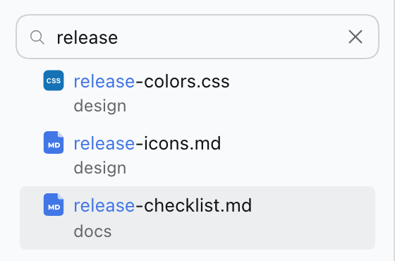
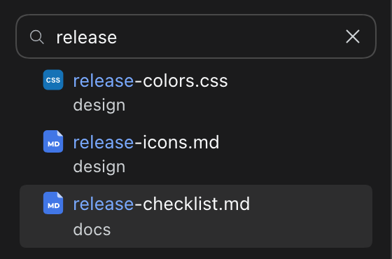

# 工作区文件

[English](README.md)

在左侧栏会话列表下方浏览当前会话的工作目录与本轮 Agent 读写过的文件，点击文件即可打开右侧内置预览。

- 点击工作区名称或三角按钮，按 **本轮文件 → 全部文件 → 收起** 三态循环切换（空心圆表示只读过，实心圆表示修改过）。
- 点击右侧放大镜可 **搜索文件名或路径**，按 `Esc` 或搜索框关闭按钮恢复先前的目录视图。

需要 DeepSeek Harness `0.2.2-rc.5`（Web 客户端）。
本插件已包含于 **工作区模块化改良计划**（`@miorin/dsh-atlas-workspace`），两者请勿同时安装。
单独安装：在本目录运行 `pnpm install --frozen-lockfile` 后，
从 **插件 → 添加插件** 选择本目录（安装期间保留目录路径不变）。

## 实拍截图

| | 浅色 | 深色 |
| --- | --- | --- |
| 工作区文件入口 |  |  |
| 文件搜索结果 |  |  |

[项目文档](docs/README.md)
